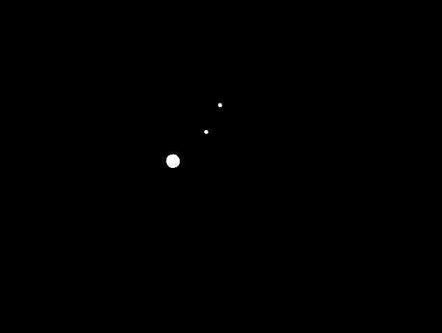

# NbodyPlanetSimulation

A 2D N-body gravity simulation written in Java with [libGDX](https://libgdx.com/). Bodies attract each other through Newtonian gravity, move using leapfrog integration, and merge when they collide.



## Quick Start

**Requirements:** JDK (add the version you use, e.g. 17+)

```bash
git clone https://github.com/Parmeson28/NbodyPlanetSimulation.git
cd NbodyPlanetSimulation
./gradlew lwjgl3:run        # Windows: gradlew.bat lwjgl3:run
```

To build a runnable jar (output in `lwjgl3/build/libs`):

```bash
./gradlew lwjgl3:jar
```

## Goals

The main goal of this project is to further my studies in computational physics simulations.

I chose Java and libGDX because I was already familiar with both from previous projects. libGDX offers good performance with simpler syntax than a lower-level alternative such as pure OpenGL.

## How It Works

### Newtonian gravity

The force between every pair of bodies is calculated each frame with a nested loop over all bodies (O(N²)):

```
F = G * (m1 * m2) / r²
```

| Symbol | Meaning |
|--------|---------|
| F | Resulting force |
| G | Gravitational constant |
| m1, m2 | Masses of the two bodies |
| r | Distance between the bodies |

Each body is an instance of the `Body` class, which stores its position, velocity, acceleration, mass and radius. When two bodies collide, they merge: the one with more mass absorbs the other.

### Leapfrog integration

Updating position with an old velocity value is not very accurate. With leapfrog integration, velocity is kept half a step ahead of position, which gives a more realistic result. Each frame does:

1. Half-step update: add half of the acceleration to the velocity, then update the position
2. Recalculate the forces with Newton's law using the new positions
3. Half-step update: add the other half of the acceleration to the velocity

Reference: [Leapfrog integration notes (UCSD)](https://jduarte.physics.ucsd.edu/phys141/_downloads/98b2b44e12426a0a101effebb1ad7144/leapfrog.pdf)

## Project Structure

- `core`: main module with the simulation logic, shared by all platforms
- `lwjgl3`: desktop launcher using LWJGL3
- `assets`: project assets

## Roadmap

- [x] Newtonian gravity with O(N²) force calculation
- [x] Collisions with merging
- [x] Leapfrog integration
- [ ] Barnes-Hut algorithm to reduce the cost per frame ([reference](https://www1.univap.br/irapuan/Tese/treecode/treecode.htm))

## Built With

- Java
- [libGDX](https://libgdx.com/) (project generated with [gdx-liftoff](https://github.com/libgdx/gdx-liftoff))
- Gradle

## License

No license defined yet.
